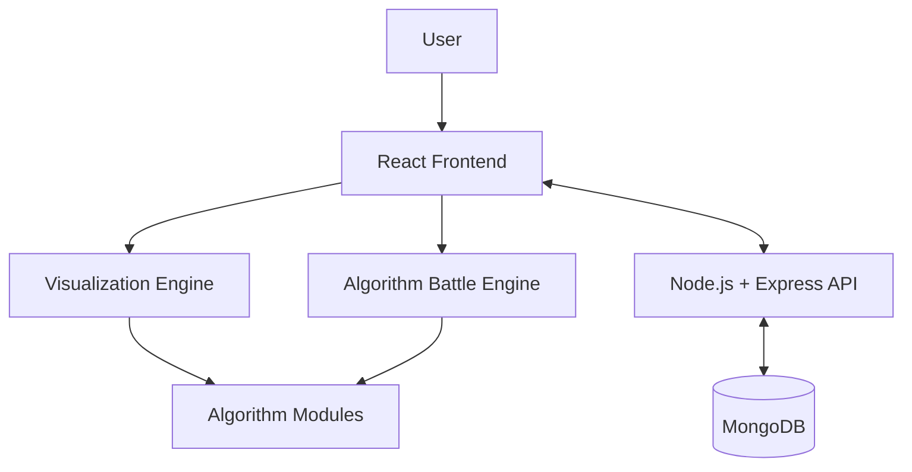

# ⚔️ AlgoArena – Interactive Algorithm Battle & Visualization Platform

<p align="center">
  <b>Understand Algorithms. Visualize Every Step. Challenge Their Performance.</b>
</p>

<p align="center">
  An interactive computer science learning platform that transforms complex algorithms into visual experiences and competitive performance battles.
</p>

<p align="center">
  
  
  
  
</p>

---

## 🚀 Overview

**AlgoArena** is an interactive algorithm visualization and comparison platform designed to make Data Structures and Algorithms easier to understand.

Instead of simply reading pseudocode or theoretical explanations, users can watch algorithms execute step by step, explore their internal operations, and compare different approaches using identical datasets.

The platform combines algorithm visualization, performance analysis, interactive learning, and competitive challenges into one environment.

Its central concept is simple:

**What happens when two algorithms compete against the same problem?**

---

## ✨ Core Features

### 1. Algorithm Visualizer
Explore algorithms through step-by-step animations.

**Sorting Algorithms**
- Bubble Sort
- Selection Sort
- Insertion Sort
- Merge Sort
- Quick Sort
- Heap Sort

**Searching Algorithms**
- Linear Search
- Binary Search

**Graph Algorithms**
- Breadth-First Search (BFS)
- Depth-First Search (DFS)
- Dijkstra's Shortest Path
- A* Search

**Dynamic Programming**
- Fibonacci
- 0/1 Knapsack
- Longest Common Subsequence

### 2. ⚔️ Algorithm Battle Mode

The signature feature of AlgoArena.

Compare two algorithms side by side using the same input dataset.

Example battles:
- Quick Sort vs Merge Sort
- Bubble Sort vs Insertion Sort
- BFS vs DFS

Comparison metrics:
- Number of comparisons
- Number of swaps or movements
- Total operations
- Execution time
- Time complexity
- Space complexity

The platform distinguishes theoretical complexity from measured runtime.

### 3. Interactive Controls

- Play and pause animations
- Resume execution
- Reset visualization
- Step-by-step execution
- Animation speed adjustment
- Random dataset generation
- Custom input arrays

### 4. Complexity Analyzer

Understand algorithm efficiency through:

- Best-case complexity
- Average-case complexity
- Worst-case complexity
- Space complexity
- Big-O explanations

### 5. Learning Mode

Every algorithm includes:
- Concept explanation
- Step-by-step pseudocode
- Working principle
- Real-world applications
- Complexity analysis
- Interactive examples

### 6. Dataset Generator

Experiment with different input patterns:

- Random arrays
- Sorted arrays
- Reverse-sorted arrays
- Duplicate values
- Nearly sorted arrays
- Custom datasets

### 7. Progress Tracking

Planned learning features:
- User accounts
- Saved algorithms
- Completed learning modules
- Quiz scores
- Challenge history
- Leaderboard

---

## 🏗️ System Architecture

AlgoArena follows a modular full-stack architecture.



### Architecture Components

| Component | Responsibility |
|---|---|
| React Frontend | User interface and interactions |
| Visualization Engine | Animates algorithm execution |
| Algorithm Modules | Independent algorithm implementations |
| Battle Engine | Executes and compares two algorithms |
| Express API | Handles backend requests |
| MongoDB | Stores users and learning progress |

---

## 🧠 How Algorithm Visualization Works

Each algorithm is implemented independently and produces a sequence of execution steps.

For example, a sorting algorithm can generate states containing:

- Current array
- Compared indices
- Swapped indices
- Operation type
- Current execution step

The visualization engine consumes these states and updates the interface.

This separation keeps algorithm logic independent from animation logic.

### Example: Sorting Execution

```text
Initial Array:
[8, 3, 6, 2, 9]

Step 1:
Compare 8 and 3

Step 2:
Swap 8 and 3

Step 3:
Compare 8 and 6

Final Sorted Array:
[2, 3, 6, 8, 9]
```

---

## 🛠️ Tech Stack

| Technology | Purpose |
|---|---|
| React.js | Frontend development |
| Vite | Development environment |
| Tailwind CSS | Styling |
| Framer Motion | Animations |
| JavaScript | Algorithm implementation |
| HTML Canvas / SVG | Visualizations |
| Recharts | Performance charts |
| Node.js | Backend runtime |
| Express.js | REST API |
| MongoDB | Database |

---

## 📂 Project Structure

```text
AlgoArena/
│
├── frontend/
│   ├── public/
│   └── src/
│       ├── components/
│       ├── pages/
│       ├── algorithms/
│       │   ├── sorting/
│       │   ├── searching/
│       │   ├── graph/
│       │   └── dynamic-programming/
│       ├── visualizer/
│       ├── battle-engine/
│       ├── hooks/
│       ├── services/
│       └── App.jsx
│
├── backend/
│   ├── controllers/
│   ├── routes/
│   ├── models/
│   ├── middleware/
│   └── server.js
│
├── tests/
│
├── docs/
│
└── README.md
```

*The structure represents the planned modular organization and may evolve during development.*

---

## ⚙️ Getting Started

### Prerequisites

- Node.js
- npm
- Git
- MongoDB (for backend features)

### Clone Repository

```bash
git clone https://github.com/Chethana45/AlgoArena.git
cd AlgoArena
```

### Frontend Setup

```bash
cd frontend
npm install
npm run dev
```

### Backend Setup

```bash
cd backend
npm install
npm run dev
```

Configure environment variables and MongoDB connection details before running backend-dependent features.

---

## 🧪 Testing

The project aims to include unit tests for individual algorithms.

Test cases include:

- Empty arrays
- Single-element arrays
- Duplicate values
- Sorted arrays
- Reverse-sorted arrays
- Negative numbers
- Large datasets

Algorithm outputs should be validated against expected results before visualization.

---

## 🗺️ Development Roadmap

- [ ] Phase 1 – Sorting algorithm visualizer
- [ ] Phase 2 – Searching algorithm visualizer
- [ ] Phase 3 – Graph algorithm visualization
- [ ] Phase 4 – Dynamic programming visualization
- [ ] Phase 5 – Algorithm Battle Mode
- [ ] Phase 6 – Complexity Analyzer
- [ ] Phase 7 – Learning Mode and quizzes
- [ ] Phase 8 – Backend and database integration
- [ ] Phase 9 – User progress and leaderboard
- [ ] Phase 10 – Testing and deployment

---

## 🎯 Project Goals

AlgoArena aims to:

- Make algorithm concepts easier to understand visually.
- Demonstrate the practical differences between algorithms.
- Encourage experimentation with different datasets.
- Connect theoretical complexity with empirical observations.
- Create an interactive environment for learning computer science.

---

## 👩‍💻 Developer

**Chethana Sri**

Computer Science & Engineering  
Madras Institute of Technology, Anna University

GitHub: [@Chethana45](https://github.com/Chethana45)

---

## ⭐ Support

If you find AlgoArena interesting, consider starring the repository and following its development.

**Learn it. Visualize it. Battle it. Master it.**

<p align="center">
  <b>Built with curiosity and a passion for Computer Science. ⚡</b>
</p>
